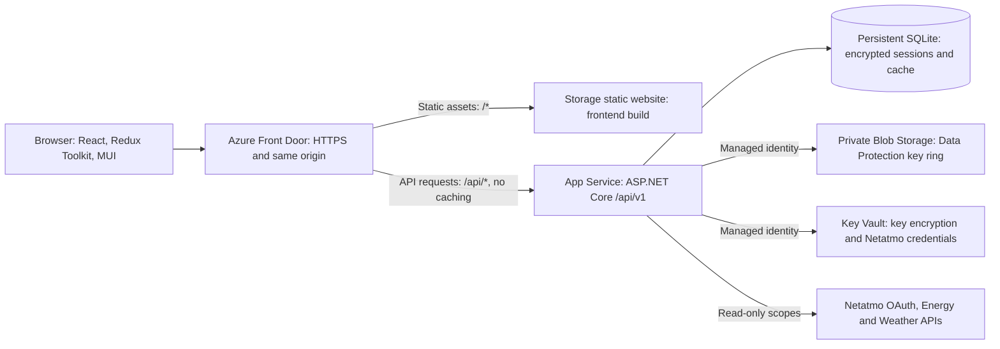
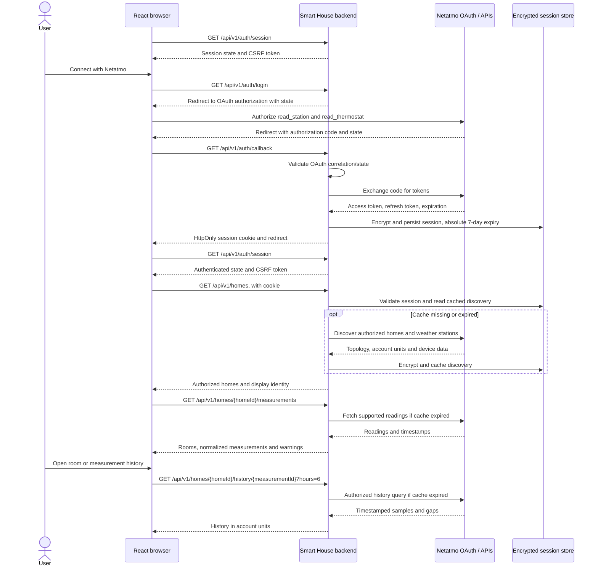

# Architecture

Smart House is a read-only dashboard for Netatmo thermostats and weather stations. The browser talks only to the Smart House backend; provider credentials and tokens never reach JavaScript.

## Components and infrastructure

The frontend is a Vite/TypeScript application with hash routes, including the dashboard, Settings, room details, and individual measurement history. RTK Query handles cookie-authenticated API calls. Each room detail shows visible readings without history first, then historical charts in the user's configured order. Charts share the selected 6/12/24/48-hour range.

Language, theme, selected home, dashboard order, visibility, and icons persist in the browser. Dashboard customization is scoped by home and room IDs, not synchronized with an account. Uploaded icons are decoded and re-encoded locally; they are never uploaded to the backend. Visibility affects presentation, not permissions or provider data retrieval.

The ASP.NET Core backend uses Minimal API endpoint modules in `Controllers/`. `DashboardService` coordinates discovery, room grouping, unit conversion, snapshots, and history. `NetatmoClient` handles provider requests and token refresh. `SessionStore` encrypts tokens and cached payloads through ASP.NET Data Protection; `SessionRepository` persists them in SQLite. A background service deletes expired sessions.

Azure production uses Front Door to serve frontend and API on one origin without CORS. App Service accepts only the configured Front Door. Managed identity accesses persistent Data Protection keys and Key Vault. Local development replaces Front Door with Vite's `/api` proxy and stores keys and SQLite under the configured local data directory.

## Login and subsequent API calls

Expired provider access tokens are refreshed on the server with coalesced requests; refreshing never extends the seven-day browser session. Revocation removes the server session. Demo mode is explicitly enabled only in Development and substitutes simulated provider responses; it is not a real-device integration check.

Browser mutations such as logout require `X-CSRF-TOKEN`. Home and measurement IDs are always checked against the authenticated session; browser visibility preferences are not authorization controls.

## Caching and failure behavior

Discovery and snapshots use one-minute session-scoped caching, with bounded in-process locks for concurrent work. Chart responses are cached in memory for one minute. Requests happen when pages open or users refresh/change history ranges; there is no polling or proprietary history archive.

Valid samples are fresh for thirty minutes and retained for at most forty-eight hours. Failed updates may preserve valid older readings without declaring them fresh. Provider errors, partial results, and revoked permissions remain explicit; an outage is not a successful empty home list.

SQLite and in-process coordination target a single backend instance. Multiple instances require shared transactional session/cache storage and distributed coordination first. Keep every Data Protection key version needed to decrypt persistent sessions.

## API contract

Backend builds export the versioned OpenAPI contract to [`../openapi/smart-house.json`](../openapi/smart-house.json). The frontend RTK Query client and standalone C# HttpClient / TypeScript Fetch SDKs are generated from it. Run `node scripts/generate-api.mjs` after contract or exported documentation changes; CI checks for drift. See [SDK setup](../sdk/README.md), [backend operations](../backend/README.md), and [Azure deployment](../infra/README.md).
